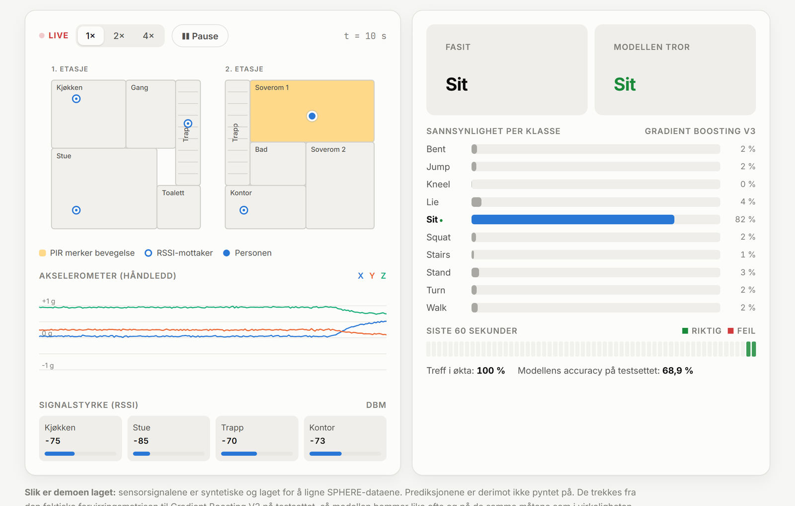
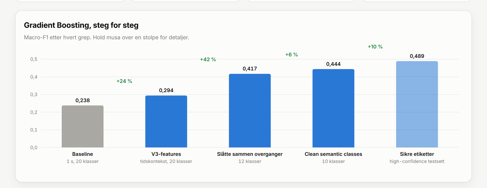
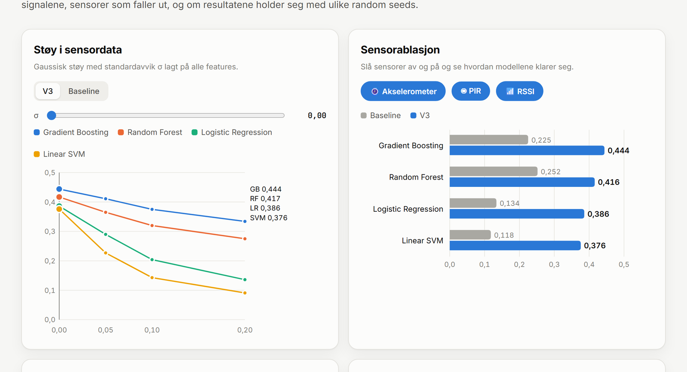

<div align="center">

# Hva gjør du nå?

**Maskinlæring som gjenkjenner aktivitet i et smarthjem, ut fra et armbånd og noen sensorer i taket.**

Bacheloroppgave i informasjonsteknologi, Høgskulen på Vestlandet, våren 2026

[**▶ Prøv live-demoen**](https://magnesvalland.github.io/har-activity-recognition/) · [Les rapporten](docs/rapport.pdf) · [Se notebooken](https://nbviewer.org/github/MagneSvalland/har-activity-recognition/blob/master/notebook/DAT191_H3.ipynb)


<a href="https://magnesvalland.github.io/har-activity-recognition/"></a>

</div>

## Kort fortalt

En person beveger seg rundt i et hus. Personen har et armbånd med akselerometer, det henger bevegelsessensorer (PIR) i taket, og fire mottakere måler signalstyrken (RSSI) fra armbåndet. Ut fra dette skal en modell si hva personen gjør, hvert eneste sekund: sitter, står, går, ligger, går i trappa, bøyer seg ned.

Vi brukte det åpne [SPHERE-datasettet](https://irc-sphere.ac.uk/) og sammenlignet seks modelltyper langs tre akser:

| | Spørsmålet vi stilte |
|---|---|
| **Ytelse** | Hvor ofte gjetter modellen riktig, også på sjeldne aktiviteter? |
| **Robusthet** | Hva skjer med støy i signalene, eller hvis en sensor faller ut? |
| **Forklarbarhet** | Hva ser modellen egentlig etter når den bestemmer seg? |

## Resultatet i ett bilde



Den første versjonen vår så på ett og ett sekund isolert og prøvde å skille 20 aktiviteter. Det ga en macro-F1 på 0,255. Vi kunne ha prøvd større modeller, men problemet lå i dataene. Så vi bygde dem om:

1. **Tidskontekst.** Femsekunders vinduer med variabler for hva som skjedde rett før og rett etter.
2. **Ryddige klasser.** 20 overlappende klasser ble slått sammen til 10. «Sit to stand» er nå en del av «Stand».
3. **Usikre etiketter.** Hvert sekund i SPHERE er annotert av flere personer. Der de var uenige, filtrerte eller vektet vi ned.

Med samme modelltype (Gradient Boosting) gikk macro-F1 fra **0,238 til 0,444**, og til **0,489** på sekunder der annotatørene var enige. Det viktigste funnet i oppgaven er nettopp dette: **bedre data og tidskontekst betydde mer enn mer kompliserte modeller.** En 1D-CNN trent på rå tidsserier endte på 0,279.

| Modell | Baseline macro-F1 | V3 macro-F1 | V3 accuracy |
|---|---:|---:|---:|
| **Gradient Boosting** | 0,238 | **0,444** | **68,9 %** |
| Random Forest | 0,255 | 0,417 | 67,9 % |
| Logistic Regression | 0,144 | 0,386 | 52,6 % |
| Linear SVM | 0,133 | 0,376 | 51,0 % |
| 1D-CNN (V1 / rå V2) | 0,239 | 0,279 | 34,2 % |
| Dummy (gjetter alltid flest) | 0,028 | 0,032 | 19,1 % |

## Robusthet



* **Støy:** Gradient Boosting mister 25 % av ytelsen ved kraftig støy (σ = 0,2). De lineære modellene mister mellom 65 og 76 %.
* **Sensorer:** Akselerometer og RSSI alene gir 0,447, like godt som alle tre sensorene. PIR bidrar nesten ingenting. Et billigere oppsett ville holdt.
* **Random seed:** 0,446 ± 0,002 over tre kjøringer. Forbedringen er ikke flaks.

## Forklarbarhet

SHAP og permutation importance viste at modellene endret strategi mellom versjonene. Baseline så nesten bare på vinkelen til håndleddet (gjennomsnittlig akselerasjon per akse). V3 kombinerer variasjon i bevegelse med signalstyrke mot trappa og kjøkkenet, og bruker aktivt sekundene før og etter. Det forklarer mye av forbedringen, men er også en svakhet: en modell som lærer seg rommene i ett hus vil ikke nødvendigvis fungere i et annet.

## Det som fortsatt er vanskelig

Stille aktiviteter som Sit, Stand og Lie treffer rundt 0,75 til 0,78 i F1. Korte overganger er en annen sak. «Turn» og «Squat» varer et par sekunder, er sjeldne, og ser ut som å stå stille fra et armbånd. Modellen klarer nesten aldri å fange dem. I tillegg har 21 % av sekundene under 60 % enighet mellom annotatørene, og det setter et tak på hvor gode resultatene kan bli.

## Live-demoen

[Demosiden](https://magnesvalland.github.io/har-activity-recognition/) har en smarthjem-simulator, interaktive grafer for alle resultatene, en støyslider, brytere for å slå av sensorer og en utforsker for SHAP og permutation importance.

Sensorsignalene i simulatoren er syntetiske. Prediksjonene er derimot trukket fra den faktiske forvirringsmatrisen til Gradient Boosting V3 på testsettet, så modellen i demoen bommer like ofte og på samme måte som den ekte. Alle tall på siden er hentet direkte fra notebooken.

Siden er én HTML-fil uten byggesteg ([docs/index.html](docs/index.html)). For å kjøre lokalt kan du bare åpne filen i nettleseren.

## Innhold

```
├── notebook/
│   └── DAT191_H3.ipynb      Hele analysen: datautforsking, baseline, V3-pipeline,
│                            1D-CNN, robusthet, SHAP og sammenligning
└── docs/
    ├── index.html           Live-demoen (GitHub Pages)
    ├── rapport.pdf          Bacheloroppgaven (56 sider)
    ├── prosjekthandbok.pdf  Vedlegg A: planlegging, metode og fremdrift
    └── presentasjon.pdf     Vedlegg B: lenke til videopresentasjonen
```

Notebooken ble kjørt i Google Colab med data og mellomresultater lagret i en delt Drive-mappe. For å kjøre den selv må du laste ned SPHERE-datasettet og peke `BASE_CACHE_DIR` til din egen mappe. Alle utdata ligger lagret i notebooken, så den kan leses uten å kjøres.

## Metode

| | Baseline | V3 |
|---|---|---|
| Tidsoppløsning | Ett sekund, isolert | 5 s vinduer med lag- og lead-variabler |
| Klasser | 20 originale klasser | 10 semantisk sammenslåtte klasser |
| Etikettusikkerhet | Argmax av sannsynligheter | Filtrering (confidence > 0,6) og vekting |
| Modeller | Dummy, LogReg, Linear SVM, Random Forest, Gradient Boosting, 1D-CNN | De samme klassiske modellene og en sekvensbasert 1D-CNN på rådata |
| Evaluering | Accuracy, precision, recall, macro-F1, weighted-F1 | I tillegg støy, sensorablasjon, random seed, SHAP og permutation importance |

## Forfattere

Hans Christian Gustafsson, Jonatan Dam og Magne Svalland<br>
Institutt for datateknologi, elektroteknologi og realfag, HVL<br>
Veileder: Faiga Alawad

## Lisens

Koden i notebooken og demosiden er delt under [MIT-lisensen](LICENSE). Rapporten, prosjekthåndboken og presentasjonen er akademisk arbeid levert til HVL og deles her som referanse. Alle rettigheter til disse tilhører forfatterne.

SPHERE-datasettet tilhører SPHERE-prosjektet ved University of Bristol og er ikke inkludert i dette repoet.
